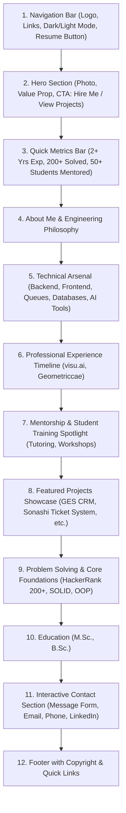
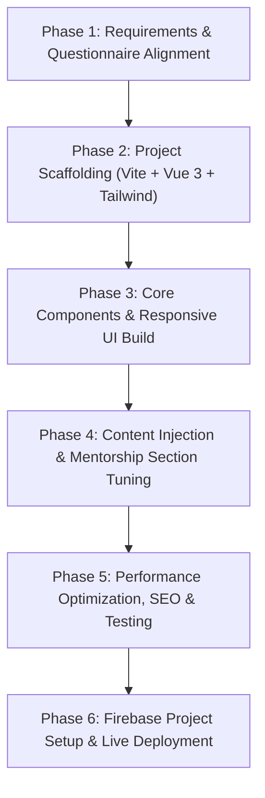

# 🚀 Venkateshwaran S — Portfolio Implementation Plan & Blueprint

> **Goal**: Build a modern, high-performance, responsive personal portfolio website showcasing Venkateshwaran's expertise as a **Full Stack Developer** (Python, Django, PHP, Laravel, Vue.js, Asynchronous Task Systems) and his impactful work as a **Technical Mentor / Tutor** for college students, deployed seamlessly on **Firebase Hosting**.

---

## 1. Profile & Asset Integration Summary

| Attribute | Details |
| :--- | :--- |
| **Name** | Venkateshwaran S |
| **Title** | Full Stack Developer & Asynchronous Systems Specialist |
| **Location** | Chennai, Tamil Nadu, India |
| **Contact** | venkateshwaran2810@gmail.com • +91-9600449363 |
| **Profiles** | [LinkedIn: venkateshwaran28](https://www.linkedin.com/in/venkateshwaran28) |
| **Experience** | ~2 Years (visu.ai, Geometriccae Engineering Services) |
| **Specializations** | Backend API Architecture (Django/Laravel), Celery/RabbitMQ, Vue.js 3, Redis & MySQL Optimization |
| **Community Impact** | Tutor & Mentor for college students pursuing internships & real-world software training |
| **Profile Photo** | Uploaded portrait ready (`profile_venkat.jpg`) |


---

## 2. Proposed Architecture & Tech Stack

```mermaid
flowchart LR
    subgraph Frontend["Modern Frontend Stack"]
        Vue["Vue.js 3 / Vite"]
        Tailwind["Tailwind CSS 3 / 4"]
        Icons["Lucide Icons"]
        Animate["Smooth Motion / Transitions"]
    end

    subgraph Build["Build & Optimization"]
        ViteBuild["Vite Production Build (Dist)"]
        SEO["SEO / OpenGraph Metadata"]
    end

    subgraph Cloud["Firebase Hosting"]
        CLI["Firebase CLI (v15.4.0)"]
        FBHosting["Firebase CDN (SSL / Global Edge)"]
        Domain["venkat-portfolio.web.app / Custom Domain"]
    end

    Frontend --> Build
    Build --> CLI
    CLI --> FBHosting
    FBHosting --> Domain
```



### Why Vue.js 3 + Tailwind CSS?
1. **Direct Resume Alignment**: Vue.js 3 is one of your key frontend technologies. Using Vue 3 proves your skills directly to recruiters and engineering managers.
2. **Lightning Fast**: Paired with Vite, the site delivers sub-second load times, instant HMR during development, and minimal bundle sizes.
3. **Responsive & Modern Styling**: Tailwind CSS provides clean, responsive, dark-mode-first glassmorphism styling with micro-animations.
4. **Firebase Hosting Ready**: Produces static SPA output (`dist/`) that deploys directly onto Google Firebase's global CDN with zero latency and free automated SSL.

---

## 3. Site Structure & Page Sections



### Detailed Section Breakdown

1. **Header & Navigation**:
   - Modern glassmorphic sticky header with smooth-scrolling links.
   - One-click resume download button (`Venkateshwaran_Resume.pdf`).
   - Dark/Light mode theme toggle.

2. **Hero Section**:
   - High-resolution circular/rounded portrait with subtle gradient border.
   - Catchy, professional headline: *"Building High-Performance Backend APIs, Scalable Queues & Responsive Web Apps"*.
   - Quick action buttons: **"View Work"**, **"Get In Touch"**, **"Download CV"**.

3. **Metrics Bar**:
   - `2+ Years` Professional Engineering Experience.
   - `200+` Algorithmic Problems Solved (HackerRank Java/Python).
   - `100%` Production Deployment & Asynchronous Architecture Focus.
   - Mentorship metric (e.g. `X+` College Students Mentored).

4. **Technical Skills Grid (Interactive Filters)**:
   - **Backend & APIs**: Python (Django, DRF), PHP (Laravel, CodeIgniter 3), Spring Boot.
   - **Asynchronous & Queues**: Celery, Celery Beat, RabbitMQ, Flower, Background Workers.
   - **Frontend**: Vue.js 3, JavaScript (ES6+), HTML5, CSS3, Bootstrap, Tailwind CSS.
   - **Databases & Caching**: MySQL (Indexing, Routing, Query Optimization), Redis, MongoDB.
   - **DevOps & AI Tools**: Docker, Git, Linux/Unix Shell, Postman, Google Antigravity IDE, Claude Code.

5. **Professional Experience**:
   - **visu.ai** (Associate Engineer, Feb 2026 – Present): Celery/RabbitMQ pipelines, Redis caching, Vue.js 3 dashboards, Django/Laravel APIs.
   - **Geometriccae Engineering Services** (Web Developer, Dec 2024 – Jan 2026): CodeIgniter 3, MySQL database design, REST APIs, Linux server deployments.

6. **Mentorship & Tutor Spotlight (Special Feature)**:
   - Dedicated card/section highlighting your role guiding college students into tech careers.
   - Highlights: Internship training, code reviews, hands-on web development coaching, career guidance.
   - Visual badges: *Tutor*, *Code Mentor*, *Industry Readiness Trainer*.

7. **Featured Projects**:
   - **GES CRM System**: Lead management, sales pipeline, role-based access control, AJAX reporting.
   - **Sonashi Service Ticket Management System**: Field technician repair requests, REST API integration, Flutter & MySQL.
   - Optional: Side projects, open-source repos, or portfolio source code.

8. **Contact & Socials**:
   - Direct Email (`venkateshwaran2810@gmail.com`), Phone (`+91-9600449363`), LinkedIn button.
   - Contact form with client-side validation (integrable with Formspree, EmailJS, or Firebase Firestore).

---

## 4. Step-by-Step Implementation Roadmap



### Phase 1: Requirements Alignment (Current Step)
- Clarify design preferences (color theme, tone, animations).
- Gather specifics on student mentorship activities (colleges, batch size, topics taught).
- Collect GitHub handle, resume PDF copy, and Firebase project preferences.

### Phase 2: Scaffolding & Setup
- Initialize Vite with Vue.js 3 in `d:\Venkat Work\my_projects\my_porfolio`.
- Configure Tailwind CSS, Lucide Vue icons, and responsive breakpoints.
- Set up asset directories (profile photo, resume PDF, project mockups).

### Phase 3: Component Development
- Build reusable UI components: `Navbar.vue`, `HeroSection.vue`, `SkillsSection.vue`, `ExperienceTimeline.vue`, `MentorshipCard.vue`, `ProjectCard.vue`, `ContactSection.vue`, `Footer.vue`.
- Add dark/light mode toggle with local storage persistence.

### Phase 4: Polish & Interactivity
- Smooth scroll navigation.
- Subtle entrance transitions and hover card effects.
- Mobile drawer menu for phone screens.

### Phase 5: Firebase Deployment Setup
- Configure `firebase.json` for single-page app rewrites.
- Run `npm.cmd run build` to generate optimized `dist/`.
- Run `firebase.cmd deploy --only hosting` to publish live.
- Provide custom domain setup instructions (if Venkat owns a domain).

---

## 5. Firebase Hosting Architecture

```
my_porfolio/
├── dist/                  # Optimized static production build
│   ├── index.html
│   ├── assets/
│   │   ├── index-[hash].js
│   │   ├── index-[hash].css
│   │   └── profile_venkat.jpg
├── firebase.json          # Firebase hosting routing configuration
└── .firebaserc            # Firebase project alias
```

Firebase configuration (`firebase.json`):
```json
{
  "hosting": {
    "public": "dist",
    "ignore": [
      "firebase.json",
      "**/.*",
      "**/node_modules/**"
    ],
    "rewrites": [
      {
        "source": "**",
        "destination": "/index.html"
      }
    ]
  }
}
```
